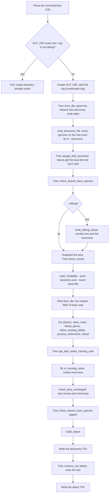
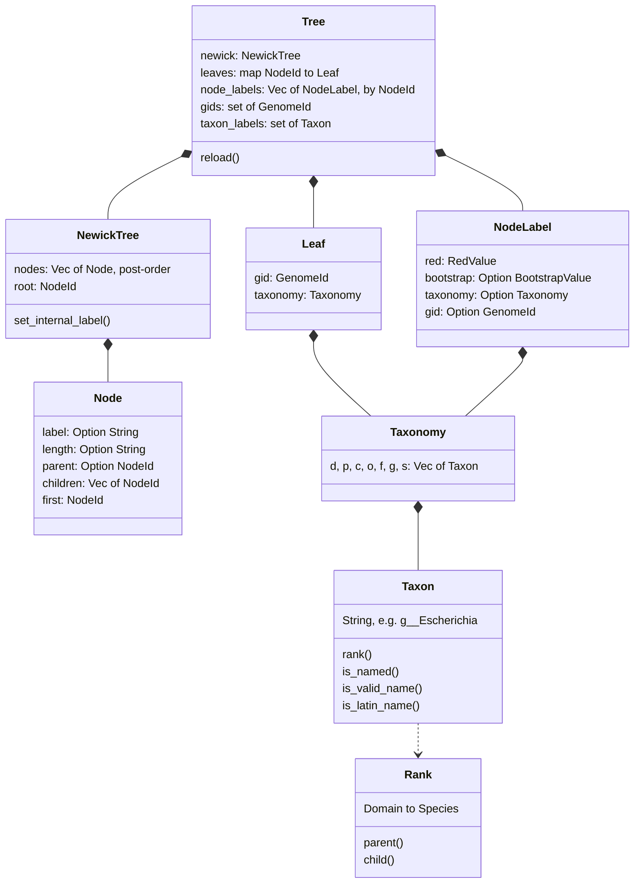
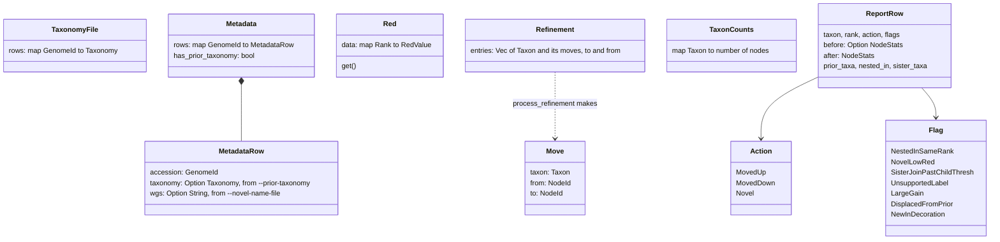
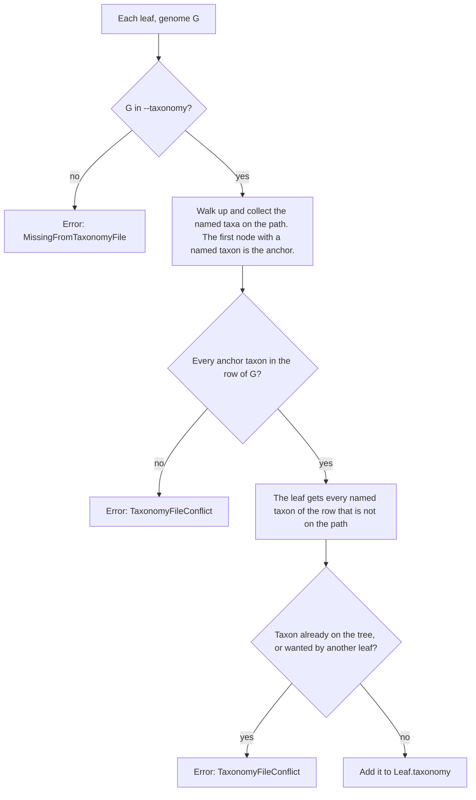
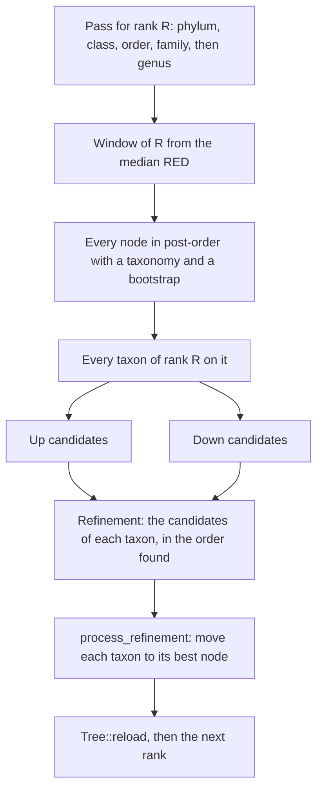
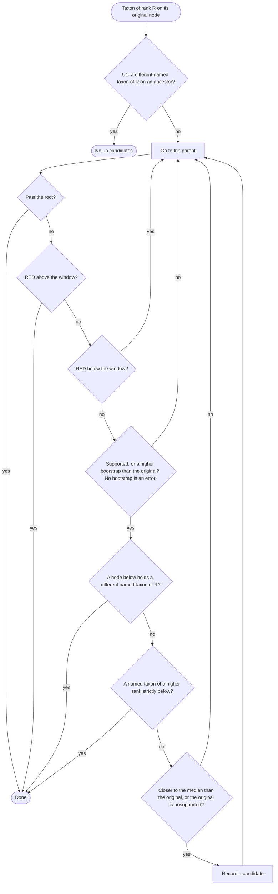
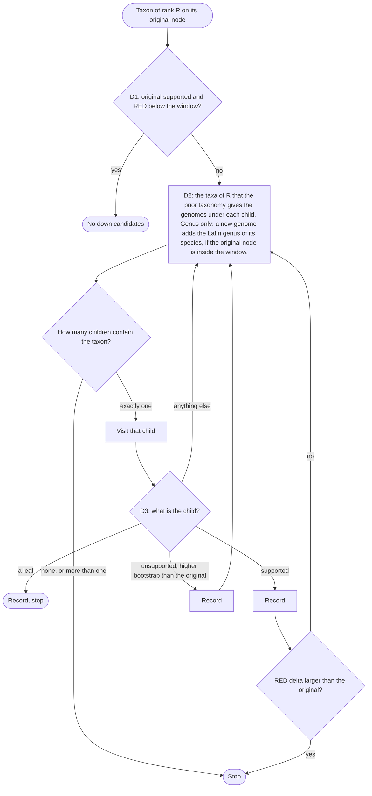
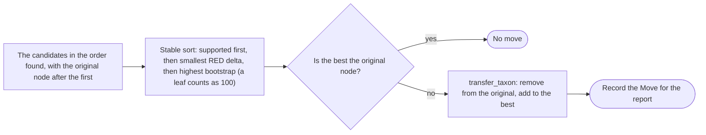
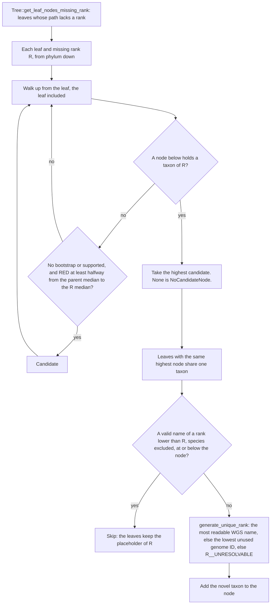

# Architecture

How curatomatic runs, the data structures it uses, and the rules it applies, as diagrams. The same diagrams,
with interactive explorers, are in [`architecture.html`](architecture.html) (see [Regenerating](#regenerating)).

This is a snapshot of the code at commit `27f27d5` (2026-11-23). The **code is the source of truth**: if this
document and the code disagree, the code is what runs. The detailed rules are in [refinement.md](refinement.md).

## Pipeline

`curate` (`src/main.rs`) runs these steps in order. Any error stops the run before output is written, except the
output directory check, which runs before the log is opened.

| Output | Written by |
| --- | --- |
| `<stem>.curatomatic.taxonomy.tsv` | `taxonomy_file::write` from `Tree::leaf_taxonomies` (nearest taxon of each rank on the path) |
| `<stem>.curatomatic.tree` | `Tree::to_file`, after `Tree::remove_red_labels` (leaf labels unchanged) |
| `<stem>.curatomatic.report.tsv` | `write_report` from `build_report` |
| `curatomatic.log` | `log::init` |
| `<stem>.debug.zombie.tree`, `<stem>.debug.taxonomy.tsv` | `write_debug_inputs` (`--debug` only) |

## Data structures

### The tree

- `NodeId` is the position of a node in post-order. Every node comes after its descendants, and the descendants of
  a node are the contiguous ids just before it (`Node.first` to the node).
- `node_labels` is derived from the Newick labels, plus the `Leaf` taxonomy for leaves. It is only up to date after
  `Tree::reload`.
- The taxa of an internal node live in its Newick label. The taxa of a leaf live on its `Leaf`, never in its label.
- `GenomeId`, `Taxon`, `RedValue` and `BootstrapValue` are newtypes over `String` and `f64`.

### Inputs, results and the report

### Node labels

| Node | Label | Example |
| --- | --- | --- |
| Leaf | `<gid>[\|RED=1.0]`. Anything else after the genome ID is `TaxonomyOnLeaf`. | `G964471825` |
| Internal | `[<bootstrap>][:][<taxonomy>]\|RED=<red>`, with a bootstrap, a taxonomy or both. The key may be `RED=` or `red=`, after `\|`, or after the `:` of a bootstrap with no taxonomy. | `100:f__CAYYKD01;g__CAYYKD01\|red=0.8386`, `100:red=0.8894` |

## RED windows

For a rank `R` with parent `P` and child `C` (the domain is fixed at 0.0 and the species at 1.0):

- **upper bound** = midpoint(median `P`, median `R`)
- **lower bound** = midpoint(median `R`, median `C`)
- a node is **inside the window** when `upper ≤ RED ≤ lower`
- **RED delta** = `|median R − RED of node|`
- a novel taxon of `R` may only go on a node with `RED ≥ halfway(median P, median R)`, which is the upper bound

## Assigning the taxonomy file to the leaves

`Tree::assign_leaf_taxonomy` (`src/tree.rs`) matches by taxon, never by rank.

## Refinement

### One pass per rank

Candidates are found on the tree as it was at the start of the pass, and are not recalculated between moves.

### Moving up (`Tree::refine_existing_labels`)

### Moving down (`Tree::refine_existing_labels`, `Tree::child_rank_taxa`)

Without `--prior-taxonomy` no genome has a prior taxonomy, so no child contains the taxon and nothing moves down.

### Choosing the move (`Tree::process_refinement`)

## Novel taxa (`fill_in_missing_ranks`)

The candidates and the valid names below each node are read before any novel taxon is created. A missing domain
has no parent rank, and is a `NoParentRank` error.

## Checks

| Check | Where | When | Error |
| --- | --- | --- | --- |
| A leaf label is its genome ID, with a RED of 1.0 if any | `parse_leaf_label` (`src/node_label.rs`) | Reading the tree | `TaxonomyOnLeaf`, `InvalidNodeLabel` |
| Every taxon is on one node, except `<rank>__UNRESOLVABLE` | `Tree::get_taxon_labels` | Every load and `reload` | `NonUniqueTaxon` |
| Every genome on the tree is in `--taxonomy` | `read_taxonomy_file` (`src/main.rs`) | After reading the tree | `MissingFromTaxonomyFile` |
| The tree and the file agree, and no taxon is given twice | `Tree::assign_leaf_taxonomy` | Leaf assignment | `TaxonomyFileConflict` |
| Leaf assignment only adds taxa | `assign_leaf_taxonomy` (`src/main.rs`) | Leaf assignment | `Invariant` |
| Every leaf holds its named species | `Tree::check_leaves_have_species` | After assignment, and before output | `LeafWithoutSpecies` |
| An ancestor inside the window has a bootstrap | `required_bootstrap` | Moving up | `Invariant` |
| A move leaves the original node with a bootstrap or a taxon | `transfer_taxon` | Applying a move | `Invariant` |
| A leaf label is never changed | `NewickTree::set_internal_label`, `NodeLabel::to_label` | Any label write | `Invariant` |
| Taxa are only moved or created | `check_taxa_unchanged` (`src/main.rs`) | Before output | `TaxaChanged` |
| Every move and novel taxon has a report row | `check_every_change_has_a_row` (`src/report.rs`) | Building the report | `Invariant` |

## Code map

| File | Holds |
| --- | --- |
| `src/main.rs` | `curate`: the pipeline, input reading, `check_taxa_unchanged`, `--debug` output |
| `src/cli.rs` | `Cli`: the command line |
| `src/tree.rs` | `Tree`, `Leaf`, leaf assignment, refinement, novel taxa, taxonomy output |
| `src/newick.rs` | `NewickTree`, `NodeId`: parsing and writing Newick, post-order arena |
| `src/node_label.rs` | `NodeLabel`: reading and writing node labels |
| `src/taxon.rs` | `Taxon`, `TaxonCounts`, `generate_unique_rank` |
| `src/taxonomy.rs` | `Taxonomy`: the taxa of each rank on one node |
| `src/taxonomy_file.rs` | `TaxonomyFile`: reading and writing the taxonomy TSV |
| `src/metadata.rs` | `Metadata`: novel names and the prior taxonomy |
| `src/red.rs` | `Red`, `RedValue`: the median RED file |
| `src/rank.rs` | `Rank` |
| `src/bootstrap.rs`, `src/genome.rs` | `BootstrapValue`, `GenomeId`, `gid_to_canonical` |
| `src/report.rs` | `build_report`, `ReportRow`, `Action`, `Flag` |
| `src/error.rs` | `CuratomaticError` |
| `src/log.rs` | The logger |

## Regenerating

This document and `architecture.html` were made once, and are not kept up to date automatically. To update them
when asked:

1. Read the code, not only the docs: `curate` in `src/main.rs`, then `src/tree.rs`, `src/node_label.rs`,
   `src/taxon.rs`, `src/report.rs` and the other files in the [code map](#code-map).
2. Compare what the code does with `AGENTS.md`, `README.md`, `docs/refinement.md` and `docs/differences.md`. Where
   they disagree, the diagrams follow the code. List each disagreement for the user, who decides whether the docs or
   the code are wrong. Do not fix either without being asked.
3. Update the diagrams here, then copy them unchanged into the `<pre class="mermaid">` blocks of
   `architecture.html`.
4. `architecture.html` has three explorers written in JavaScript that copy rules from the code. Check each against
   the code and update it:
   - the label reader copies `split_red`, `parse_leaf_label` and `parse_node_label` (`src/node_label.rs`);
   - the RED window explorer copies the bounds in `Tree::refine_existing_labels` and `fill_in_missing_ranks`, and
     holds the medians of `example/gtdb_r237_median_red_rank_distribution.tsv` and of `docs/refinement.md`;
   - the upward walk explorer copies the upward walk of `Tree::refine_existing_labels` and the sort in
     `Tree::process_refinement`.
5. Update the commit and date at the top of this document and in the footer of `architecture.html`.
6. Publish `architecture.html` to its artifact link (below) with the Artifact tool, updating it in place.
